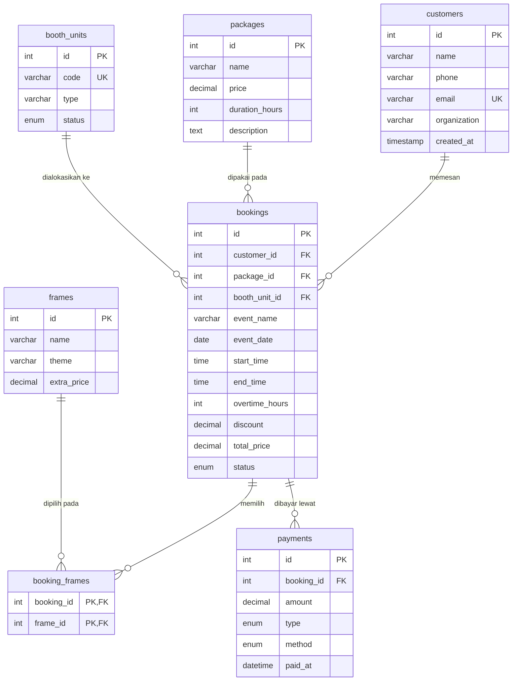
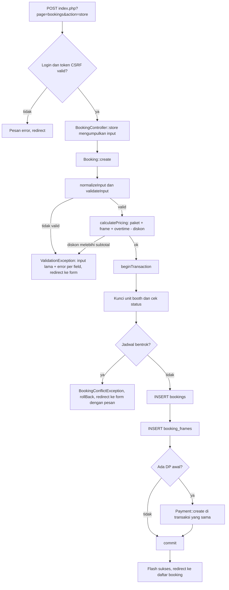

# Cekrek.in Booking Manager

Nama : Ariq Ahmad Fathir
NIM : 2506752
Kelas : C2

## Janji

Saya Ariq Ahmad Fathir dengan NIM 2506752 mengerjakan TP 7 dalam mata kuliah
Desain dan Pemrograman Berorientasi Objek untuk keberkahan-Nya, maka saya tidak melakukan
kecurangan seperti yang telah dispesifikasikan. Aamiin.

## 1. Tentang Aplikasi

Cekrek.in adalah layanan sewa photobooth portabel yang berbasis di Bandung. Booth dapat dibawa ke
berbagai acara seperti pernikahan, wisuda, gathering, dan kegiatan kampus, lengkap dengan desain
frame yang disesuaikan dengan tema acara.

Seiring bertambahnya jumlah acara, pencatatan lewat chat dan lembar kerja mulai menimbulkan masalah
yang sama berulang kali:

- dua acara dijadwalkan pada unit booth yang sama di jam yang saling tumpang tindih;
- harga akhir dihitung manual dari paket, frame, tambahan durasi, dan diskon sehingga mudah salah;
- sulit mengetahui siapa yang baru membayar DP, siapa yang sudah lunas, dan berapa sisa tagihannya;
- data customer, paket, dan unit tersebar di banyak tempat.

Cekrek.in Booking Manager adalah aplikasi web untuk admin yang memusatkan semua itu. Admin mengelola
customer, paket, frame, unit booth, booking, dan pembayaran dari satu tempat. Sistem menolak jadwal
yang bentrok, menghitung harga secara otomatis, dan menurunkan status pembayaran dari data yang
tercatat.

Seluruh data contoh pada repositori ini fiktif (nama, kontak, dan alamat bukan data sebenarnya).

## 2. Fitur Utama

- **Login admin** dengan password yang diverifikasi terhadap hash, serta tombol keluar.
- **Dashboard**: jumlah booking bulan ini, pendapatan bulan ini, total sisa tagihan, lima booking
  terdekat, dan unit booth yang paling sering dipakai.
- **CRUD lengkap** untuk customer, paket, frame, unit booth, booking, dan pembayaran.
- **Deteksi bentrok jadwal**: satu unit tidak dapat memiliki dua booking pada tanggal yang sama
  dengan jam yang beririsan. Booking yang dibatalkan tidak memblokir jadwal, dan unit yang sedang
  perawatan tidak dapat dipilih.
- **Harga otomatis**: harga paket + biaya frame terpilih + (jam tambahan x tarif per jam) - diskon.
  Diskon tidak boleh melebihi subtotal.
- **Pembayaran bertahap**: DP dan pelunasan dengan batas total tidak melebihi tagihan. Status
  (belum bayar, DP, lunas) dan sisa tagihan dihitung dari data pembayaran, tidak disimpan.
- **Aturan status booking**: status Selesai hanya dapat dipilih bila booking sudah lunas.
- **Penghapusan aman**: data yang masih dipakai tidak dapat dihapus dan admin mendapat pesan yang
  jelas. Booking yang sudah memiliki pembayaran disarankan diubah menjadi Dibatalkan.
- **Pencarian dan filter booking**: nama event atau customer, status, dan rentang tanggal, dengan
  pagination.
- **Keamanan**: prepared statement di semua query, token CSRF di semua form POST, escape output
  HTML, dan pola Post-Redirect-Get setelah form dikirim.

## 3. Rancangan Database

Database `db_cekrekin` memakai InnoDB dengan charset `utf8mb4`: enam tabel utama dan satu tabel
penghubung. Berkas lengkapnya ada di [`database/db_cekrekin.sql`](database/db_cekrekin.sql).

### Diagram relasi



### Daftar tabel

**customers** : pemesan jasa.

| Kolom | Tipe | Keterangan |
| --- | --- | --- |
| id | INT AUTO_INCREMENT | primary key |
| name | VARCHAR(100) NOT NULL | nama customer |
| phone | VARCHAR(20) NOT NULL | nomor telepon |
| email | VARCHAR(100) UNIQUE, NULL | opsional, tidak boleh kembar |
| organization | VARCHAR(100) NULL | sekolah, kampus, atau perusahaan |
| created_at | TIMESTAMP | otomatis |

**packages** : paket sewa berdasarkan durasi.

| Kolom | Tipe | Keterangan |
| --- | --- | --- |
| id | INT AUTO_INCREMENT | primary key |
| name | VARCHAR(100) NOT NULL | nama paket |
| price | DECIMAL(12,2) NOT NULL | harga paket |
| duration_hours | INT NOT NULL | durasi sewa dalam jam |
| description | TEXT | deskripsi |

**frames** : desain frame cetak.

| Kolom | Tipe | Keterangan |
| --- | --- | --- |
| id | INT AUTO_INCREMENT | primary key |
| name | VARCHAR(100) NOT NULL | nama frame |
| theme | VARCHAR(50) | tema |
| extra_price | DECIMAL(12,2) NOT NULL DEFAULT 0 | biaya tambahan |

**booth_units** : unit fisik photobooth.

| Kolom | Tipe | Keterangan |
| --- | --- | --- |
| id | INT AUTO_INCREMENT | primary key |
| code | VARCHAR(20) UNIQUE NOT NULL | kode unit, mis. BTH-001 |
| type | VARCHAR(50) NOT NULL | tipe unit |
| status | ENUM('available','maintenance') | bawaan available |

**bookings** : pemesanan acara.

| Kolom | Tipe | Keterangan |
| --- | --- | --- |
| id | INT AUTO_INCREMENT | primary key |
| customer_id | INT NOT NULL | FK ke customers(id), ON DELETE RESTRICT |
| package_id | INT NOT NULL | FK ke packages(id), ON DELETE RESTRICT |
| booth_unit_id | INT NOT NULL | FK ke booth_units(id), ON DELETE RESTRICT |
| event_name | VARCHAR(150) NOT NULL | nama acara |
| venue | VARCHAR(200) | lokasi acara |
| event_date | DATE NOT NULL | tanggal acara |
| start_time, end_time | TIME NOT NULL | jam mulai dan selesai |
| overtime_hours | INT NOT NULL DEFAULT 0 | jam tambahan |
| discount | DECIMAL(12,2) NOT NULL DEFAULT 0 | potongan harga |
| total_price | DECIMAL(12,2) NOT NULL DEFAULT 0 | total hasil perhitungan otomatis |
| status | ENUM('pending','confirmed','done','cancelled') | bawaan pending |
| notes | TEXT | catatan |
| created_at | TIMESTAMP | otomatis |

**booking_frames** : tabel penghubung booking dan frame (relasi banyak ke banyak).

| Kolom | Tipe | Keterangan |
| --- | --- | --- |
| booking_id | INT | FK ke bookings(id), ON DELETE CASCADE |
| frame_id | INT | FK ke frames(id), ON DELETE RESTRICT |
| | | primary key gabungan (booking_id, frame_id) |

**payments** : pembayaran DP atau pelunasan.

| Kolom | Tipe | Keterangan |
| --- | --- | --- |
| id | INT AUTO_INCREMENT | primary key |
| booking_id | INT NOT NULL | FK ke bookings(id), ON DELETE RESTRICT |
| amount | DECIMAL(12,2) NOT NULL | nominal |
| type | ENUM('dp','pelunasan') | jenis pembayaran |
| method | ENUM('transfer','cash','qris') | metode |
| paid_at | DATETIME NOT NULL | waktu pembayaran |
| note | VARCHAR(200) | catatan |

### Catatan relasi

- Customer, paket, dan unit booth tidak dapat dihapus selama masih dipakai booking (`RESTRICT`).
- Frame tidak dapat dihapus selama masih dipilih pada booking.
- Menghapus booking menghapus baris pada `booking_frames` (`CASCADE`), tetapi booking yang sudah
  punya pembayaran ditolak oleh aplikasi.
- Status pembayaran tidak memiliki kolom sendiri. Nilainya dihitung dari `SUM(payments.amount)`
  dibandingkan dengan `bookings.total_price`.

## 4. Struktur Folder

```
cekrekin
├── class
│   ├── core
│   │   ├── BaseModel.php            induk abstrak semua model (query generik berbasis prepared statement)
│   │   ├── Validator.php            trait aturan validasi
│   │   ├── CrudController.php       alur CRUD generik (customer, paket, frame, unit booth)
│   │   ├── BookingController.php    alur halaman booking
│   │   ├── PaymentController.php    alur halaman pembayaran
│   │   └── DashboardController.php  menyiapkan data dashboard
│   ├── exceptions
│   │   ├── ValidationException.php
│   │   ├── BookingConflictException.php
│   │   └── DeleteRestrictedException.php
│   ├── helpers
│   │   ├── Auth.php                 login dan logout admin
│   │   ├── Csrf.php                 pembuatan dan verifikasi token
│   │   ├── Flash.php                pesan sekali-tampil, input lama, error per field
│   │   ├── Html.php                 escape output, format rupiah/tanggal, badge
│   │   ├── Http.php                 URL, redirect, cek metode request
│   │   ├── Money.php                hitung uang dalam satuan sen
│   │   └── Paginator.php            perhitungan halaman
│   ├── Customer.php
│   ├── Package.php
│   ├── Frame.php
│   ├── BoothUnit.php
│   ├── Booking.php                  bentrok jadwal, harga, transaksi
│   └── Payment.php                  aturan nominal dan status pembayaran
├── config
│   ├── config.php                   konstanta aplikasi dan akun admin demo
│   ├── db.php                       class Database (singleton PDO)
│   └── autoload.php                 pemuat class otomatis
├── database
│   └── db_cekrekin.sql              struktur dan data contoh
├── view
│   ├── header.php, footer.php       kerangka halaman
│   ├── login.php
│   ├── dashboard.php
│   ├── customers.php, packages.php, frames.php, booth_units.php
│   ├── bookings.php, payments.php
│   └── partials                     potongan yang dipakai ulang (field form, pagination, tombol aksi)
├── assets
│   ├── img                          logo dan favicon
│   └── fonts                        file font (woff2) dan lisensinya
├── Dokumentasi                      tempat screen record
├── index.php                        titik masuk aplikasi
├── style.css
└── README.md
```

Pembagian tanggung jawab: `class/` menyimpan logika dan akses data, `view/` hanya menampilkan HTML
tanpa query SQL, `config/` berisi konfigurasi dan koneksi, sedangkan `index.php` mengatur jalannya
request.

## 5. Alur Kode

Setiap request melewati urutan yang sama:

```
Browser -> index.php -> controller -> model (class/) -> database (via config/db.php)
                                          |
Browser <- HTML <- view/ <- data dari model
```

1. Browser memanggil `index.php?page=...&action=...`.
2. `index.php` memuat konfigurasi dan autoloader, memulai session, lalu memeriksa login.
3. Parameter `page` memilih controller. Controller membaca input, memanggil model, lalu memilih view.
4. Model menjalankan query lewat `BaseModel::run()`, yang selalu memakai `prepare()` dan `execute()`.
5. Controller merender `header.php`, view halaman, dan `footer.php` menjadi response HTML.
6. Untuk request POST, controller memverifikasi token CSRF, memanggil model, lalu me-redirect
   dengan pesan flash (Post-Redirect-Get) sehingga memuat ulang halaman tidak mengirim form dua kali.

### Contoh lengkap: membuat booking

Admin mengisi form pada `?page=bookings&action=create` lalu menekan Simpan.



Rincian langkahnya:

1. **Controller**: `BookingController::store()` memverifikasi CSRF dan mengambil hanya field yang
   diizinkan dari `$_POST`.
2. **Validasi**: `Booking::validateInput()` memeriksa kolom wajib, format tanggal dan jam,
   `end_time > start_time`, serta keberadaan customer, paket, dan unit. Semua kesalahan dikumpulkan
   dalam satu `ValidationException` agar form dapat menampilkannya sekaligus di bawah tiap field.
3. **Harga**: `Booking::calculatePricing()` mengambil harga paket dan biaya frame dari database
   (query berparameter), menambah `overtime_hours x OVERTIME_RATE`, lalu mengurangi diskon.
   Perhitungan memakai satuan sen agar tidak terkena kesalahan pembulatan.
4. **Transaksi**: `BaseModel::transaction()` menjalankan `beginTransaction()`. Unit booth dikunci
   dengan `SELECT ... FOR UPDATE` supaya dua booking yang dibuat bersamaan tidak sama-sama lolos
   pengecekan.
5. **Bentrok jadwal**: `findConflict()` mencari booking lain pada unit dan tanggal yang sama,
   yang bukan `cancelled`, dengan syarat `start_baru < end_lama AND end_baru > start_lama`.
   Bila ada, `BookingConflictException` dilempar dengan pesan yang menyebut booking yang bentrok.
6. **Penyimpanan**: booking disimpan, lalu frame yang dipilih disimpan pada `booking_frames`.
   Bila admin mengisi DP awal, `Payment::create()` dipanggil dalam transaksi yang sama.
7. **Commit atau rollback**: bila semua berhasil, `commit()`. Bila ada exception di langkah mana
   pun, `rollBack()` membatalkan seluruhnya sehingga tidak ada booking tanpa frame atau DP tanpa
   booking.
8. **Respons**: controller menyimpan pesan sukses di session dan me-redirect ke daftar booking.
   Bila gagal, input lama dan pesan error disimpan lalu admin diarahkan kembali ke form.

### Aturan bisnis ringkas

| Aturan | Letak |
| --- | --- |
| Bentrok jadwal per unit, booking batal diabaikan | `Booking::findConflict()` |
| Unit perawatan tidak dapat dipilih | `Booking::lockAndCheckSchedule()` |
| Total = paket + frame + overtime - diskon, tidak negatif | `Booking::calculatePricing()` |
| Booking Selesai hanya bila lunas | `Booking::update()` |
| Total booking tidak boleh lebih kecil dari uang yang sudah masuk | `Booking::update()` |
| Total pembayaran tidak melebihi total tagihan | `Payment::assertAmountAllowed()` |
| Pelunasan harus menutup sisa, DP harus menyisakan tagihan | `Payment::assertAmountAllowed()` |
| Status bayar diturunkan dari data pembayaran | `Payment::summarize()` |
| Hapus data yang masih dipakai ditolak | `ensureDeletable()` pada tiap model |

### Penanganan Error

Aplikasi memisahkan error berdasarkan penyebabnya. Setiap jenis ditangani di tempat yang tepat dan hasilnya dikembalikan ke admin sebagai pesan yang jelas, tanpa pernah menampilkan error mentah dari PHP atau database.

#### Cara error ditampilkan

- **Pesan di bagian atas halaman.** Berwarna merah untuk error, hijau untuk sukses, dan biru untuk informasi. Pesan disimpan di session lewat class `Flash`, tampil satu kali, lalu hilang.
- **Pesan di bawah kolom form.** Kesalahan validasi ditandai pada kolom yang bermasalah, dengan garis merah dan teks penjelasan.
- **Input lama dipertahankan.** Ketika form ditolak, isian sebelumnya tetap terisi sehingga admin cukup memperbaiki bagian yang salah.
- **Pola Post-Redirect-Get.** Setelah form dikirim, baik berhasil maupun gagal, server melakukan redirect. Memuat ulang halaman tidak mengirim form untuk kedua kalinya.

#### Jenis error dan penanganannya

| Jenis | Dilempar oleh | Ditangani | Hasil untuk admin |
| --- | --- | --- | --- |
| Input tidak valid | `ValidationException` | Controller | Form kembali dengan input lama dan pesan di bawah kolom |
| Jadwal bentrok | `BookingConflictException` | Controller | Form kembali dengan pesan yang menyebut booking yang bentrok |
| Data masih dipakai | `DeleteRestrictedException` | Controller | Penghapusan dibatalkan, daftar tampil dengan pesan penjelasan |
| Kesalahan database | `PDOException` | Controller | Pesan umum, detail teknis hanya dicatat di log server |
| Token CSRF tidak valid | `RuntimeException` | `index.php` | Request dibatalkan dan admin diarahkan kembali dengan pesan |
| Data atau halaman tidak ada | Pengecekan di controller | Controller | Pesan "tidak ditemukan" dan redirect ke daftar |
| Database tidak dapat dihubungi | `RuntimeException` | `index.php` | Halaman error sederhana dengan petunjuk memeriksa MySQL |
| Kesalahan tak terduga | `Throwable` | `index.php` | Pesan umum, detail dicatat di log server |

#### Contoh pesan yang tampil

| Situasi | Pesan |
| --- | --- |
| Login salah | Username atau password salah. |
| Email sudah terdaftar | Email sudah dipakai customer lain. |
| Kode unit kembar | Kode unit sudah dipakai unit lain. |
| Jam selesai lebih awal dari jam mulai | Jam selesai harus setelah jam mulai. |
| Diskon melebihi subtotal | Diskon tidak boleh melebihi subtotal (Rp 1.000.000). |
| Jadwal bentrok | Jadwal bentrok dengan booking #3 "Wisuda SMA Negeri Contoh 99" (14/11/2026, 08:00-10:00) pada unit BTH-001. |
| Unit sedang perawatan | Unit "BTH-003" sedang dalam perawatan dan tidak dapat dipilih. |
| Status Selesai belum lunas | Booking hanya dapat berstatus Selesai jika sudah lunas. Sisa tagihan: Rp 500.000. |
| Pembayaran melebihi tagihan | Nominal melebihi sisa tagihan. Sisa tagihan saat ini: Rp 1.450.000. |
| Pelunasan tidak menutup sisa | Pelunasan harus menutup seluruh sisa tagihan (Rp 1.450.000). Gunakan tipe DP untuk pembayaran sebagian. |
| Hapus customer yang punya booking | Customer "Rina Maharani" tidak dapat dihapus karena masih memiliki 2 booking. Hapus booking terkait terlebih dahulu. |
| Hapus booking yang sudah dibayar | Booking ini sudah memiliki 2 pembayaran sehingga tidak dapat dihapus. Ubah statusnya menjadi Dibatalkan agar riwayat pembayaran tetap tersimpan. |
| Token CSRF salah | Token keamanan tidak valid atau kedaluwarsa. Silakan muat ulang halaman. |

#### Kegagalan di tengah proses (rollback)

Pembuatan dan perubahan booking terdiri dari beberapa langkah: menyimpan booking, menyimpan frame yang dipilih, dan mencatat DP awal. Semuanya berjalan dalam satu transaksi database:

1. `beginTransaction()` dipanggil sebelum langkah pertama.
2. Bila semua langkah berhasil, `commit()` menyimpan seluruh perubahan.
3. Bila salah satu langkah gagal, termasuk validasi DP yang baru diperiksa di akhir, `rollBack()` membatalkan semuanya lalu error diteruskan ke controller.

Akibatnya tidak ada kondisi setengah tersimpan, misalnya booking tanpa frame atau pembayaran tanpa booking. Sebagai contoh, booking dengan DP awal yang melebihi total tagihan ditolak sepenuhnya, dan booking tersebut tidak muncul di daftar.

Untuk mencegah dua permintaan yang berjalan bersamaan sama-sama lolos pengecekan, unit booth dan baris booking dikunci dengan `SELECT ... FOR UPDATE` selama transaksi berlangsung.

#### Prinsip yang dipakai

- **Validasi di server.** Atribut seperti `required` dan `min` di HTML hanya membantu pengguna. Semua aturan diperiksa ulang di server dan tidak bergantung pada browser.
- **Pesan untuk pengguna, detail untuk log.** Kesalahan database dan kesalahan tak terduga dicatat lewat `error_log()`, sedangkan layar hanya menampilkan pesan umum. Dengan begitu nama tabel, query, dan kredensial tidak pernah terlihat di browser.
- **Foreign key sebagai lapis kedua.** Pengecekan hapus di aplikasi mencegah error sebelum terjadi, sedangkan `ON DELETE RESTRICT` di database menjadi jaring pengaman. Bila foreign key tetap menolak, pesannya diterjemahkan menjadi pesan yang ramah.
- **Semua aksi pengubah data memakai POST dan token CSRF.** Permintaan tanpa token yang cocok ditolak sebelum menyentuh model.

## 6. Penerapan OOP

**Abstract class dan inheritance (`BaseModel`).** Semua model memerlukan koneksi, nama tabel, dan
operasi dasar yang sama (`all`, `find`, `delete`, `count`, `exists`). Hal itu ditulis sekali di
`BaseModel`. `create()` dan `update()` dibuat abstrak karena kolom tiap tabel berbeda, sehingga
setiap turunan (`Customer`, `Package`, `Frame`, `BoothUnit`, `Booking`, `Payment`) wajib
mendefinisikannya sendiri. Dengan begitu tidak ada kode CRUD yang diulang dan model baru cukup
mewarisi kelas yang sama.

**Template method (`delete()` dan `ensureDeletable()`).** `delete()` di `BaseModel` selalu memanggil
`ensureDeletable()` sebelum menghapus. Metode itu kosong secara bawaan dan di-override oleh model
yang punya aturan sendiri, misalnya `Customer` yang menolak hapus bila masih punya booking.
Alur penghapusan tetap satu, sedangkan aturan penolakannya menyesuaikan tiap entitas.

**Singleton (`Database`).** Koneksi PDO cukup dibuat satu kali per request dan dipakai bersama oleh
semua model. Constructor dibuat private dan akses lewat `Database::getInstance()`. Selain hemat
koneksi, semua model berada pada koneksi yang sama sehingga satu transaksi dapat mencakup beberapa
model (contohnya booking dan DP awal).

**Trait (`Validator`).** Validasi adalah kemampuan tambahan yang dapat dipasang ke class mana pun
tanpa mengubah hierarki pewarisan. Aturan seperti `required`, `email`, `max:N`, `date`, `time`,
`decimal`, dan `in:...` dipakai ulang oleh seluruh model lewat `BaseModel`.

**Custom exception.** Tiap kegagalan bisnis punya tipe sendiri sehingga ditangani secara berbeda
oleh controller:

- `ValidationException` membawa pesan error per field untuk ditampilkan di form.
- `BookingConflictException` membawa data booking yang bentrok.
- `DeleteRestrictedException` membawa pesan ramah ketika data masih dipakai, sehingga error mentah
  dari foreign key tidak pernah sampai ke pengguna.

**Enkapsulasi dan pemisahan tanggung jawab.** Properti koneksi dan tabel bersifat `protected`,
`BaseModel::run()` menjadi satu-satunya pintu eksekusi query, dan controller dipisah dari model dan
view. `CrudController` menangani empat entitas sederhana sekaligus, sedangkan `BookingController`,
`PaymentController`, dan `DashboardController` dipisah karena alurnya lebih khusus.

## 7. Cara Menjalankan

Kebutuhan: PHP 8.0 atau lebih baru dengan ekstensi `pdo_mysql`, serta MySQL atau MariaDB.
Laragon dan XAMPP sudah memenuhinya.

1. **Letakkan proyek.** Salin folder `cekrekin` ke `C:\laragon\www` (Laragon) atau
   `C:\xampp\htdocs` (XAMPP).
2. **Nyalakan layanan.** Jalankan Apache dan MySQL dari panel Laragon atau XAMPP.
3. **Impor database.** Buka phpMyAdmin, pilih tab Import, lalu pilih `database/db_cekrekin.sql`.
   Berkas ini membuat database `db_cekrekin`, seluruh tabel, dan data contoh. Alternatif lewat
   terminal:

   ```
   mysql -u root < database/db_cekrekin.sql
   ```

4. **Sesuaikan konfigurasi bila perlu.** Buka `config/config.php`. Nilai bawaan (`root` tanpa
   password) sesuai dengan instalasi Laragon/XAMPP standar. Tarif overtime (`OVERTIME_RATE`) dan
   jumlah data per halaman (`PER_PAGE`) juga diatur di sini.
5. **Buka aplikasi.** Akses `http://localhost/cekrekin/`.

Akun demo:

| Username | Password |
| --- | --- |
| admin | admin123 |

Password tidak disimpan polos. `config.php` hanya memuat hash hasil `password_hash()`. Untuk
menggantinya, buat hash baru dengan `php -r "echo password_hash('password-baru', PASSWORD_DEFAULT);"`
lalu isikan ke `ADMIN_PASSWORD_HASH`.

Catatan tampilan: font dipasang langsung di folder `assets/fonts` (Plus Jakarta Sans untuk judul,
Inter untuk teks isi, berlisensi SIL OFL), sehingga tampilan sama baik online maupun offline.
Atkinson Hyperlegible, font isi brand Cekrek.in, juga sudah tersedia dan dapat dipakai dengan
mengubah `--font-body` di `style.css`. Font judul brand, Negrita Pro, berlisensi sehingga tidak
disertakan. Bila filenya dimiliki, taruh di `assets/fonts` lalu ikuti petunjuk di
`assets/fonts/README.txt`.

## 8. Dokumentasi

Screen record penggunaan aplikasi diletakkan di folder `Dokumentasi`.

- Login dan logout, serta dashboard

      

https://github.com/user-attachments/assets/16d5b5d9-ad27-4b75-af80-bffa6516c0ff


- Customer: tambah, ubah, hapus


https://github.com/user-attachments/assets/dcc25fe7-236a-46cd-a185-a799a88763cf


- Paket: tambah, ubah, hapus


https://github.com/user-attachments/assets/d9146fba-6fc9-4a2d-9dec-96ee9f8e56f2


- Frame: tambah, ubah, hapus


https://github.com/user-attachments/assets/1797dfcc-41c1-4507-90f8-471ce2270aff


  
- Unit booth: tambah, ubah, hapus


https://github.com/user-attachments/assets/7c2138e6-c478-4101-a457-04a3a73e4196


- Booking: tambah, ubah, hapus, serta pencarian dan filter


https://github.com/user-attachments/assets/3e015933-c275-471e-b163-58ce84e7c96b


- Pembayaran: catat DP, catat pelunasan, ubah, hapus


https://github.com/user-attachments/assets/7dc6410a-9043-40c0-abe3-9723354f502b


- Error handling (salah input, bentrok jadwal, penghapusan data yang masih dipakai, dll)


https://github.com/user-attachments/assets/34984d20-cf90-44cc-abf0-079c108b458c


